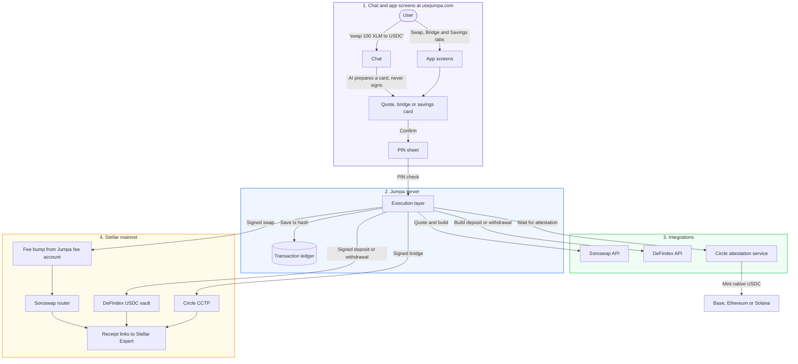

# Tranche 3: Production Mainnet Launch — Implementation & Verification Guide

> **Jumpa Web Application** (`jumpa-web-app`), live at [usejumpa.com](https://usejumpa.com)  
> **Status:** Live on Stellar Mainnet & All Four Metrics Met  
> **Scope:** Production deployment of Soroswap swaps, DeFindex yield savings and Circle CCTP cross-chain bridging on Stellar mainnet, public integration documentation, and a Stellar Expert audit trail, on Next.js 16 / React 19.  
> **Reporting Period:** 23 August to 15 November 2026. Every figure below comes from our production transaction ledger and was cross-checked against Stellar mainnet.

---

## Table of Contents

1. [Executive Summary](#executive-summary)
2. [Deliverables at a Glance](#deliverables-at-a-glance)
3. [Milestones & Architecture Overview](#1-milestones--architecture-overview)
4. [Milestone 1: Conversational Swaps via Soroswap](#2-milestone-1-conversational-swaps-via-soroswap)
5. [Milestone 2: DeFi Savings Yield via DeFindex](#3-milestone-2-defi-savings-yield-via-defindex)
6. [Milestone 3: Cross-Chain Bridging via Circle CCTP](#4-milestone-3-cross-chain-bridging-via-circle-cctp)
7. [On-Chain Verification via Stellar Expert](#5-on-chain-verification-via-stellar-expert)
8. [How Completion Was Measured & Verified](#6-how-completion-was-measured--verified)
9. [Codebase Directory & File Reference Map](#7-codebase-directory--file-reference-map)

---

## Executive Summary

Tranche 2 proved the conversational loops on testnet. Tranche 3 put them in front of real people with real money. Jumpa now runs on Stellar mainnet at usejumpa.com, and users swap XLM and USDC, save USDC and bridge it to other chains from the same chat.

**Soroswap** swaps, **DeFindex** yield savings and **Circle CCTP** bridging are live in production. Bridging runs on CCTP instead of Allbridge, as set out in the Tranche 2 migration plan. Section 4 explains why.

```
TRANCHE 3 - MAINNET
PRODUCTION MAINNET LAUNCH

Milestones & Deliverables:
✓ Mainnet Deployments: Soroswap swaps, DeFindex yield savings and cross-chain bridging (Circle CCTP) live on the Jumpa production web application.
✓ Public Documentation: User and developer guide covering Jumpa's integration architecture, key derivation path and data privacy safeguards, published on the official Jumpa website.
✓ On-chain Verification: Mainnet swaps, bridges and savings deposits record their transaction hash and link to the Stellar Expert explorer.
```

Every mainnet metric was met:

| Metric | Target | Result |
| :--- | :--- | :--- |
| Swap or cross-border transactions settled on Stellar mainnet | 50 | **171** (157 swaps and 14 bridges) |
| Value swapped or bridged on mainnet | $5,000 | **$6,580** |
| Active savings goals holding stablecoins in DeFindex | 20 | **27** |
| Production app live, with public transaction links | Live | usejumpa.com, where every on-chain receipt links to Stellar Expert |

---

## Deliverables at a Glance

| Deliverable | Status | Where to find it |
| :--- | :--- | :--- |
| Soroswap swaps on mainnet | Live | Chat, and the Swap tab at `/swap` |
| DeFindex yield savings on mainnet | Live | `/savings` |
| Cross-chain bridging (planned on Allbridge) | Live on Circle CCTP v2 | Chat, and the Bridge tab at `/swap` |
| Public user and developer guide | Published | [usejumpa.com/docs/stellar-integrations](https://usejumpa.com/docs/stellar-integrations) |
| Public audit trail on Stellar Expert | Live | Receipts in the app, and the transaction hashes in sections 2 to 4 |

---

## 1. Milestones & Architecture Overview

The shape is the same as in Tranche 2. What changed for mainnet: Circle CCTP replaced the Allbridge simulation, a fee account now pays network fees on swaps, and every transaction settles on Stellar mainnet with its hash saved to the ledger.



Three rules hold across every flow. The AI assistant only prepares a card and never touches keys. Every transaction the user starts needs their 4-digit PIN. Every transaction's hash goes into the ledger and onto the user's receipt.

---

## 2. Milestone 1: Conversational Swaps via Soroswap

A user types something like "swap 100 XLM to USDC" in chat, or opens the swap screen. We ask the Soroswap API for a quote across the liquidity it aggregates (Soroswap's own pools, Aqua, Phoenix and the Stellar DEX) and show it as a card the user can edit. Nothing moves until they confirm with their 4-digit PIN. The server then:

1. checks the balance, holding back the XLM that Stellar locks as the account reserve;
2. opens a USDC trustline if the wallet doesn't have one yet;
3. builds the transaction through Soroswap, signs it with the user's key, and wraps it in a fee bump so Jumpa pays the network fee;
4. submits it to mainnet and records it with its hash;
5. charges a flat $0.05 USDC service fee when the swap is into or out of USDC.

Of the 157 mainnet swaps, 149 went through the Soroswap router contract. The Soroswap API routed the other 8 through the Stellar DEX or Soroswap's aggregator.

**Soroswap router (mainnet):** [`CAG5LRYQ5JVEUI5TEID72EYOVX44TTUJT5BQR2J6J77FH65PCCFAJDDH`](https://stellar.expert/explorer/public/contract/CAG5LRYQ5JVEUI5TEID72EYOVX44TTUJT5BQR2J6J77FH65PCCFAJDDH)

### 2.1 Top 20 Mainnet Swaps by Value

These 20 swaps come to $4,845.11 of the $6,119.34 swapped in the period. Each one calls `swap_exact_tokens_for_tokens` on the Soroswap router, and Jumpa's fee account paid its network fee through a fee bump.

| # | Date | Swap | Transaction hash |
| :--- | :--- | :--- | :--- |
| 1 | 21 Oct 2026 | 4,640 XLM to 839.5646 USDC | [7ed9151ae414850d66d9dc87dab54a505fe5da4db7477913e6cbea954b452c8c](https://stellar.expert/explorer/public/tx/7ed9151ae414850d66d9dc87dab54a505fe5da4db7477913e6cbea954b452c8c) |
| 2 | 5 Oct 2026 | 3,800 XLM to 836.6335 USDC | [dde2f73b4938e8952043c958c65973b24e29f6e6160b4649173b1c97da069b63](https://stellar.expert/explorer/public/tx/dde2f73b4938e8952043c958c65973b24e29f6e6160b4649173b1c97da069b63) |
| 3 | 2 Nov 2026 | 2,410.9636 XLM to 400.6112 USDC | [dcd28d9fabccfa8a741ef1216ada2cdc594014513689658f9403ee2228d3dc6d](https://stellar.expert/explorer/public/tx/dcd28d9fabccfa8a741ef1216ada2cdc594014513689658f9403ee2228d3dc6d) |
| 4 | 22 Oct 2026 | 2,280 XLM to 401.7657 USDC | [e8ae7f5f44270e9a35add6d6d5f1d676a54da09b0111c6c003089b83bf6e6c25](https://stellar.expert/explorer/public/tx/e8ae7f5f44270e9a35add6d6d5f1d676a54da09b0111c6c003089b83bf6e6c25) |
| 5 | 30 Sep 2026 | 300 USDC to 1,345.6372 XLM | [7277a980adee6af617da72d6793c908c4cf4cbb6c68d2df7a03552961030eaaa](https://stellar.expert/explorer/public/tx/7277a980adee6af617da72d6793c908c4cf4cbb6c68d2df7a03552961030eaaa) |
| 6 | 30 Sep 2026 | 1,357 XLM to 298.5626 USDC | [38c6f3f1fdf1fe2c9325a915f4e7a89b2f50de4c5f57d64e7dcafa196d05f1d7](https://stellar.expert/explorer/public/tx/38c6f3f1fdf1fe2c9325a915f4e7a89b2f50de4c5f57d64e7dcafa196d05f1d7) |
| 7 | 26 Sep 2026 | 200 USDC to 904.0297 XLM | [f5de7da0ddc10cf1639fc216e03af2c4c9a26f9fbd1dba8f6bd0ec06a94d766e](https://stellar.expert/explorer/public/tx/f5de7da0ddc10cf1639fc216e03af2c4c9a26f9fbd1dba8f6bd0ec06a94d766e) |
| 8 | 26 Sep 2026 | 907 XLM to 199.3979 USDC | [9a2a5888c87aa2f2db8f061cccc35781714040dfdadd850369cbb03dcbb60d46](https://stellar.expert/explorer/public/tx/9a2a5888c87aa2f2db8f061cccc35781714040dfdadd850369cbb03dcbb60d46) |
| 9 | 29 Sep 2026 | 190 USDC to 816.2291 XLM | [6ea2819e709c468a2e47324b177001f33a41d67db4289b673c5bf998cf86e3b9](https://stellar.expert/explorer/public/tx/6ea2819e709c468a2e47324b177001f33a41d67db4289b673c5bf998cf86e3b9) |
| 10 | 29 Sep 2026 | 820 XLM to 189.0062 USDC | [b5ab4a7b3db7442465a22b8a20760fe76861d0a2166f622494deae45b4e71ce7](https://stellar.expert/explorer/public/tx/b5ab4a7b3db7442465a22b8a20760fe76861d0a2166f622494deae45b4e71ce7) |
| 11 | 29 Sep 2026 | 150 USDC to 646.4995 XLM | [625b9ed7ecfd39c09ee79f26d0c3481be06bee0d8d58d95a4fb4932b9d1aaf65](https://stellar.expert/explorer/public/tx/625b9ed7ecfd39c09ee79f26d0c3481be06bee0d8d58d95a4fb4932b9d1aaf65) |
| 12 | 3 Nov 2026 | 100.7023 USDC to 619.0597 XLM | [ebb9427a93a3b0bce72959647fbc7c9f06ec91ef597e4df04334838792a480b7](https://stellar.expert/explorer/public/tx/ebb9427a93a3b0bce72959647fbc7c9f06ec91ef597e4df04334838792a480b7) |
| 13 | 12 Nov 2026 | 690.0801 XLM to 100.3087 USDC | [299648b5f33a469f9762a95ec9361e6c9677818b713af4fdd7ca437cd8ee8831](https://stellar.expert/explorer/public/tx/299648b5f33a469f9762a95ec9361e6c9677818b713af4fdd7ca437cd8ee8831) |
| 14 | 11 Oct 2026 | 500 XLM to 98.3791 USDC | [b64560e90762a2a8ebbef7102665e6f57b4d721e47ef11b35d7c562b2aa4ab29](https://stellar.expert/explorer/public/tx/b64560e90762a2a8ebbef7102665e6f57b4d721e47ef11b35d7c562b2aa4ab29) |
| 15 | 24 Oct 2026 | 536.0901 XLM to 90.2632 USDC | [964a98c853d8e05b6d719a2b2fd99b271d948f44f8bfaeb719536c69780c49f5](https://stellar.expert/explorer/public/tx/964a98c853d8e05b6d719a2b2fd99b271d948f44f8bfaeb719536c69780c49f5) |
| 16 | 16 Oct 2026 | 498.7698 XLM to 91.1805 USDC | [d755d6661853bae1c255306cecf9f37aa05d67e69f33823dd9f1d433c8f2cf54](https://stellar.expert/explorer/public/tx/d755d6661853bae1c255306cecf9f37aa05d67e69f33823dd9f1d433c8f2cf54) |
| 17 | 24 Oct 2026 | 90.2632 USDC to 532.8833 XLM | [6ed58cb545fe513575959ec74f9eda08f0b49e2a3eeb59e06bb5af33e153301c](https://stellar.expert/explorer/public/tx/6ed58cb545fe513575959ec74f9eda08f0b49e2a3eeb59e06bb5af33e153301c) |
| 18 | 24 Oct 2026 | 90.1678 USDC to 529.6958 XLM | [1f554ad6655c85ef2da0f8af94dfaa5812638002c47dd030742039af35ec9301](https://stellar.expert/explorer/public/tx/1f554ad6655c85ef2da0f8af94dfaa5812638002c47dd030742039af35ec9301) |
| 19 | 24 Oct 2026 | 532.8833 XLM to 90.1678 USDC | [b454657c1553684c0ab43e6fdfacb7a1e7f2b4c2fc0a4cbf337044ddb58895ac](https://stellar.expert/explorer/public/tx/b454657c1553684c0ab43e6fdfacb7a1e7f2b4c2fc0a4cbf337044ddb58895ac) |
| 20 | 4 Oct 2026 | 375 XLM to 80.4533 USDC | [00af6a81afc19ee5f07437bcba852732cdf2af6e36a4c497e0d7c45e29867c84](https://stellar.expert/explorer/public/tx/00af6a81afc19ee5f07437bcba852732cdf2af6e36a4c497e0d7c45e29867c84) |

---

## 3. Milestone 2: DeFi Savings Yield via DeFindex

USDC savings goals deposit into a DeFindex vault on mainnet. The user tops up a goal and confirms it with their PIN, and every top-up goes through one deposit routine:

1. The DeFindex API builds the deposit transaction for the vault.
2. We sign it with the user's key, write a pending record, then send it through DeFindex.
3. A resolver confirms pending deposits on chain. Because the record exists before the transaction is sent, a deposit that confirms after a timeout is still credited, and only once.

Balances and APY in the app are read live from the vault. A withdrawal redeems the user's vault shares back into USDC in their own wallet.

At the end of the period, 27 active USDC goals held funds in the vault, against a target of 20.

**DeFindex vault (mainnet):** [`CCPAXQPQQALOPBRTWUJ6EMSCVSGQLADQLITHZIFHW4J2MV5QIB3T23VV`](https://stellar.expert/explorer/public/contract/CCPAXQPQQALOPBRTWUJ6EMSCVSGQLADQLITHZIFHW4J2MV5QIB3T23VV)

### 3.1 Top 20 Savings Deposits by Value

Users made 108 deposits into the vault in the period. The 20 largest come to $549.40, and each one calls `deposit` on the vault.

| # | Date | Deposit | Transaction hash |
| :--- | :--- | :--- | :--- |
| 1 | 2 Nov 2026 | 100 USDC | [1a389fd20de272013c7365219467d80cc1efb7298bfa3b415d5e66a0035ca53f](https://stellar.expert/explorer/public/tx/1a389fd20de272013c7365219467d80cc1efb7298bfa3b415d5e66a0035ca53f) |
| 2 | 13 Nov 2026 | 50 USDC | [5fe90a4f70102b6c5caaa82abf8cd4a19d3691dc628227271251d2439afb2ec7](https://stellar.expert/explorer/public/tx/5fe90a4f70102b6c5caaa82abf8cd4a19d3691dc628227271251d2439afb2ec7) |
| 3 | 12 Nov 2026 | 50 USDC | [966d8ad7f04530ce34a428f13c5fbf1393e2498258a59f875eacf66a1f16eaa4](https://stellar.expert/explorer/public/tx/966d8ad7f04530ce34a428f13c5fbf1393e2498258a59f875eacf66a1f16eaa4) |
| 4 | 30 Oct 2026 | 50 USDC | [44d6b5f108255f64f0bf91c1d35e321d194d413716b003fddb4143121df0e688](https://stellar.expert/explorer/public/tx/44d6b5f108255f64f0bf91c1d35e321d194d413716b003fddb4143121df0e688) |
| 5 | 25 Oct 2026 | 50 USDC | [ea74c46be151a458ce4e6c1a1e91150306e167b95316aa098cb3ddaeddf00bb6](https://stellar.expert/explorer/public/tx/ea74c46be151a458ce4e6c1a1e91150306e167b95316aa098cb3ddaeddf00bb6) |
| 6 | 14 Nov 2026 | 25 USDC | [7e674df9f215d0c3d37850d56c34b27901f05d73cbfbf428b037d85463a115b7](https://stellar.expert/explorer/public/tx/7e674df9f215d0c3d37850d56c34b27901f05d73cbfbf428b037d85463a115b7) |
| 7 | 13 Nov 2026 | 25 USDC | [eb06ce73bae7880d3014f6c62120307f1d7684327b98403e5ad2ebc99f651921](https://stellar.expert/explorer/public/tx/eb06ce73bae7880d3014f6c62120307f1d7684327b98403e5ad2ebc99f651921) |
| 8 | 15 Nov 2026 | 20 USDC | [5301dfd611a0c3e45396c6360062e51c3e68d908e76b1470f00aad723d767f6f](https://stellar.expert/explorer/public/tx/5301dfd611a0c3e45396c6360062e51c3e68d908e76b1470f00aad723d767f6f) |
| 9 | 12 Nov 2026 | 20 USDC | [054b4c7ecb6e9e67c064307e7ca961a4a9106bf73156b65bbcc8f416a9504072](https://stellar.expert/explorer/public/tx/054b4c7ecb6e9e67c064307e7ca961a4a9106bf73156b65bbcc8f416a9504072) |
| 10 | 25 Oct 2026 | 20 USDC | [2592190a84e43e8ae8152b94abde157f656016ca92975cf87cd35f5b2459a3ab](https://stellar.expert/explorer/public/tx/2592190a84e43e8ae8152b94abde157f656016ca92975cf87cd35f5b2459a3ab) |
| 11 | 21 Oct 2026 | 20 USDC | [c64c0fd2fdfe60a785771284c80f838937ca30e578969113754741c08f241883](https://stellar.expert/explorer/public/tx/c64c0fd2fdfe60a785771284c80f838937ca30e578969113754741c08f241883) |
| 12 | 15 Nov 2026 | 15 USDC | [e57b878fd2ed3905bc85c64d2b5fb275c5b18e4d262c373d6f8ae756e04a74e1](https://stellar.expert/explorer/public/tx/e57b878fd2ed3905bc85c64d2b5fb275c5b18e4d262c373d6f8ae756e04a74e1) |
| 13 | 3 Nov 2026 | 15 USDC | [82228d7b67a2dcaab5afab4dd0af7e47637a83ad2c66e0f133d8676a8a4aa6cf](https://stellar.expert/explorer/public/tx/82228d7b67a2dcaab5afab4dd0af7e47637a83ad2c66e0f133d8676a8a4aa6cf) |
| 14 | 1 Nov 2026 | 15 USDC | [fec13f27ca686e815816628b5930c7fb8e41369e5dc1bb00282cbf8fb1f8e6cd](https://stellar.expert/explorer/public/tx/fec13f27ca686e815816628b5930c7fb8e41369e5dc1bb00282cbf8fb1f8e6cd) |
| 15 | 23 Oct 2026 | 15 USDC | [aa6d8347e4d8c8007955e2884536ced84769e76b941ceedef97e262d5a312c9e](https://stellar.expert/explorer/public/tx/aa6d8347e4d8c8007955e2884536ced84769e76b941ceedef97e262d5a312c9e) |
| 16 | 15 Nov 2026 | 14.8 USDC | [0e80d8dc8895eea751752d1f816cd760ec650b09b34b5b38c9950f4aa2af110a](https://stellar.expert/explorer/public/tx/0e80d8dc8895eea751752d1f816cd760ec650b09b34b5b38c9950f4aa2af110a) |
| 17 | 15 Nov 2026 | 14.6 USDC | [4d415d534bb9097def9eb638f2fa3db8fcd1515f0280e8155359d28990e88637](https://stellar.expert/explorer/public/tx/4d415d534bb9097def9eb638f2fa3db8fcd1515f0280e8155359d28990e88637) |
| 18 | 15 Nov 2026 | 10 USDC | [fd18ea80be94d4ba0ced78c92ac46a7b2e08bd6cf8b5a0dc214a39202c1eeb7d](https://stellar.expert/explorer/public/tx/fd18ea80be94d4ba0ced78c92ac46a7b2e08bd6cf8b5a0dc214a39202c1eeb7d) |
| 19 | 26 Oct 2026 | 10 USDC | [cb7105e1ea67acd9ec4853e0f0d467c7dac7c7dd5c2bdf0f907b34d3b1d7c730](https://stellar.expert/explorer/public/tx/cb7105e1ea67acd9ec4853e0f0d467c7dac7c7dd5c2bdf0f907b34d3b1d7c730) |
| 20 | 22 Oct 2026 | 10 USDC | [91f893ef34f9b290b4690e4b34aa6af9f4ff0d35b2e1a22e7835c5f6a791b869](https://stellar.expert/explorer/public/tx/91f893ef34f9b290b4690e4b34aa6af9f4ff0d35b2e1a22e7835c5f6a791b869) |

---

## 4. Milestone 3: Cross-Chain Bridging via Circle CCTP

We switched bridging from Allbridge to Circle CCTP. Allbridge was exploited and paused its routes, so it could no longer process transactions on Stellar. As planned in our Tranche 2 report, Jumpa now bridges USDC with Circle CCTP, between Stellar and Base, Ethereum and Solana.

In the period, users made 14 bridges out of Stellar, worth $460.61.

**CCTP contract on Stellar:** [`CAE2G5Z77UP7GYPYGFOWFGW7C7J6I4YP2AFGSADRKQY62SYUFLPNFTXL`](https://stellar.expert/explorer/public/contract/CAE2G5Z77UP7GYPYGFOWFGW7C7J6I4YP2AFGSADRKQY62SYUFLPNFTXL)

### 4.1 All 14 Mainnet Bridges Out of Stellar

Every bridge out of Stellar in the period, listed by value.

| # | Date | Bridge | Transaction hash |
| :--- | :--- | :--- | :--- |
| 1 | 24 Oct 2026 | 250.00 USDC, Stellar to Solana | [5b29c8071fa22c8a319e7905b27614d87af0c1a601a32ebacf30a864b7aef4cd](https://stellar.expert/explorer/public/tx/5b29c8071fa22c8a319e7905b27614d87af0c1a601a32ebacf30a864b7aef4cd) |
| 2 | 28 Oct 2026 | 74.30 USDC, Stellar to Solana | [4243fe17124b39dd49e2ecd3849cf9b9913247aadb4ef69103059364b6246f92](https://stellar.expert/explorer/public/tx/4243fe17124b39dd49e2ecd3849cf9b9913247aadb4ef69103059364b6246f92) |
| 3 | 14 Nov 2026 | 50.00 USDC, Stellar to Solana | [ee9673b8e1ffbe34fec1f53a1b08c8951efe67dda0d49aa359f33b0b18967a16](https://stellar.expert/explorer/public/tx/ee9673b8e1ffbe34fec1f53a1b08c8951efe67dda0d49aa359f33b0b18967a16) |
| 4 | 14 Nov 2026 | 20.20 USDC, Stellar to Solana | [6f72726645281146f8d74c650f25f4f9692a2daf416f99e304a861236a9d37da](https://stellar.expert/explorer/public/tx/6f72726645281146f8d74c650f25f4f9692a2daf416f99e304a861236a9d37da) |
| 5 | 23 Oct 2026 | 15.00 USDC, Stellar to Solana | [ac6b37ea65fd99f62c2fed2cd7320478935aa23b3c40270514238eb914dbc973](https://stellar.expert/explorer/public/tx/ac6b37ea65fd99f62c2fed2cd7320478935aa23b3c40270514238eb914dbc973) |
| 6 | 15 Nov 2026 | 10.00 USDC, Stellar to Base | [313c912703b9d9114ab871a1eb09579e2839e1fc1588ab8f9bf968e70e3cd48c](https://stellar.expert/explorer/public/tx/313c912703b9d9114ab871a1eb09579e2839e1fc1588ab8f9bf968e70e3cd48c) |
| 7 | 24 Oct 2026 | 10.00 USDC, Stellar to Solana | [6ae49f354f6bfc9aa33715a001c20fb86b84d4b3c77f168cf9d4e0d31a89f5bf](https://stellar.expert/explorer/public/tx/6ae49f354f6bfc9aa33715a001c20fb86b84d4b3c77f168cf9d4e0d31a89f5bf) |
| 8 | 14 Oct 2026 | 10.00 USDC, Stellar to Solana | [0d194f7533d97e6931e8b68070e642297f1ee612f4703d27a42c24a687e09e3a](https://stellar.expert/explorer/public/tx/0d194f7533d97e6931e8b68070e642297f1ee612f4703d27a42c24a687e09e3a) |
| 9 | 14 Nov 2026 | 8.50 USDC, Stellar to Solana | [5335dc009a18ba5fd016a1bfb7307a86f2d432fb77680e62f1a9f16349abb219](https://stellar.expert/explorer/public/tx/5335dc009a18ba5fd016a1bfb7307a86f2d432fb77680e62f1a9f16349abb219) |
| 10 | 14 Nov 2026 | 5.86 USDC, Stellar to Base | [64127398e1ae9525aaba331632272d5e94b4eaf6ded76ad83260d4b3c292cf04](https://stellar.expert/explorer/public/tx/64127398e1ae9525aaba331632272d5e94b4eaf6ded76ad83260d4b3c292cf04) |
| 11 | 15 Nov 2026 | 5.10 USDC, Stellar to Solana | [bb37239b68fc33ac04bd4f9d4584d777d8e24828ba3d3dd4997ad0c62996be0c](https://stellar.expert/explorer/public/tx/bb37239b68fc33ac04bd4f9d4584d777d8e24828ba3d3dd4997ad0c62996be0c) |
| 12 | 14 Nov 2026 | 1.00 USDC, Stellar to Solana | [6a2c78b8c52318a89d2c18776d619d70d238f75d7b838bf924e08c5682aa8890](https://stellar.expert/explorer/public/tx/6a2c78b8c52318a89d2c18776d619d70d238f75d7b838bf924e08c5682aa8890) |
| 13 | 14 Nov 2026 | 0.34 USDC, Stellar to Base | [1e7905249dbddc3c38e42bda24404601d7d388713f539641c2bbab9a2e1eab37](https://stellar.expert/explorer/public/tx/1e7905249dbddc3c38e42bda24404601d7d388713f539641c2bbab9a2e1eab37) |
| 14 | 3 Nov 2026 | 0.30 USDC, Stellar to Base | [3542c2d625855a60737bd0512b8f62d52c7aa8e9c7a89f83832d4345649e01f9](https://stellar.expert/explorer/public/tx/3542c2d625855a60737bd0512b8f62d52c7aa8e9c7a89f83832d4345649e01f9) |

---

## 5. On-Chain Verification via Stellar Expert

Every swap, bridge and savings deposit in our ledger stores its Stellar transaction hash. Users see the matching Stellar Expert link on their receipt in chat and on the swap and bridge screens. Sections 2 to 4 list 54 of those hashes: the 20 largest swaps, the 20 largest savings deposits and all 14 bridges.

The quickest public check is Jumpa's fee account. It pays the network fee on swaps and wallet transfers through fee bumps, so it appears on them. Since 17 September 2026 it has taken part in 1,490 mainnet transactions, 905 of them fee bumps on user transactions.

| What | Address |
| :--- | :--- |
| Jumpa fee account | [`GAB72B74GG24KKJMASIYPFFDCHPZ7GJK4TZBTG7HFPN4K5GUKRSQF4IB`](https://stellar.expert/explorer/public/account/GAB72B74GG24KKJMASIYPFFDCHPZ7GJK4TZBTG7HFPN4K5GUKRSQF4IB) |
| Soroswap router | [`CAG5LRYQ…CCFAJDDH`](https://stellar.expert/explorer/public/contract/CAG5LRYQ5JVEUI5TEID72EYOVX44TTUJT5BQR2J6J77FH65PCCFAJDDH) |
| DeFindex vault | [`CCPAXQPQ…IB3T23VV`](https://stellar.expert/explorer/public/contract/CCPAXQPQQALOPBRTWUJ6EMSCVSGQLADQLITHZIFHW4J2MV5QIB3T23VV) |
| Circle CCTP | [`CAE2G5Z7…FLPNFTXL`](https://stellar.expert/explorer/public/contract/CAE2G5Z77UP7GYPYGFOWFGW7C7J6I4YP2AFGSADRKQY62SYUFLPNFTXL) |

To repeat our checks, open any transaction in sections 2 to 4 and confirm that it succeeded and that it calls the contract named above its table. On the swaps, also confirm that the Jumpa fee account paid the fee.

---

## 6. How Completion Was Measured & Verified

> 💡 **Step-by-Step Testing Guide:** For a hands-on walkthrough on mainnet, see the Tranche 3 section of [`HOW_TO_TEST.md`](HOW_TO_TEST.md).

The figures come from the production transaction ledger: records with status `CONFIRMED`, network `mainnet` and chain `stellar`, created between 23 August and 15 November 2026. We checked all 54 transactions listed in this report on Horizon, and each one succeeded and calls the contract we name.

- **Metric 1** counts `SWAP` and `BRIDGE` records on Stellar: 157 + 14 = 171.
- **Metric 2** adds up their dollar value. Each record stores its USD value when it runs. 86 of the 157 swaps were missing that field, so for those we used the USDC side of the swap, which the ledger also stores. For example, a swap of 218.4567 XLM into 30.09 USDC counts as $30.09. Swaps came to $6,119.34 and bridges to $460.61, which makes $6,579.95.
- **Metric 3** counts savings goals that are in USDC, attached to the DeFindex vault, active, and holding a balance above zero: 27.
- **Metric 4** is the production app at usejumpa.com, with each receipt linking to the transaction on Stellar Expert.

---

## 7. Codebase Directory & File Reference Map

| Component / Feature | File Path | Key Functions / Exports |
| :--- | :--- | :--- |
| **Soroswap Client** | [`lib/dex/soroswap/client.ts`](../lib/dex/soroswap/client.ts) | `fetchSoroswapQuote`, `buildSoroswapTransaction` |
| **Stellar Swap Execution** | [`lib/execution/stellar-swap.ts`](../lib/execution/stellar-swap.ts) | `executeStellarSwap` |
| **Fee Bumps & Fee Account** | [`lib/chains/stellar/sponsor.ts`](../lib/chains/stellar/sponsor.ts) | `wrapWithFeeBump`, `sponsoredSubmit`, `ensureSufficientStellarGas`, `collectStellarGasFeeUsdc` |
| **DeFindex Client** | [`lib/chains/stellar/defindex-client.ts`](../lib/chains/stellar/defindex-client.ts) | `DefindexClient` (`deposit`, `withdraw`, `getBalance`, `getApy`, `send`) |
| **USDC Savings Deposits** | [`lib/services/savings-usdc.ts`](../lib/services/savings-usdc.ts)<br/>[`lib/services/savings-execution.ts`](../lib/services/savings-execution.ts) | `moveUsdcIntoPlan`<br/>`depositSavingsExecution`, `withdrawSavingsExecution` |
| **CCTP Bridging** | [`lib/execution/bridge-execute.ts`](../lib/execution/bridge-execute.ts)<br/>[`lib/chains/stellar/cctp-bridge.ts`](../lib/chains/stellar/cctp-bridge.ts)<br/>[`lib/chains/solana/cctp-bridge.ts`](../lib/chains/solana/cctp-bridge.ts) | `executeBridge`<br/>`relayToStellar`<br/>`relayToSolana` |
| **PIN Verification** | [`lib/execution/verify-pin.ts`](../lib/execution/verify-pin.ts) | `verifyWalletPin` |
| **Contract Addresses** | [`lib/blockchain.ts`](../lib/blockchain.ts) | `CONTRACT_ADDRESSES` |
| **Transaction Schema** | [`models/Transaction.ts`](../models/Transaction.ts) | `Transaction` (`SWAP`, `BRIDGE`, `SAVINGS_DEPOSIT`, `SAVINGS_WITHDRAW`) |
| **Savings Plan Schema** | [`models/SavingsPlan.ts`](../models/SavingsPlan.ts) | `SavingsPlan` |
| **Public Docs Content** | [`lib/docs/content.ts`](../lib/docs/content.ts) | `DOCS_PAGES["stellar-integrations"]` |
