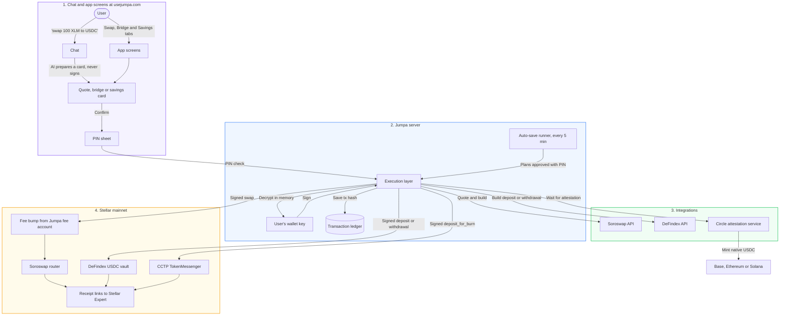

# Tranche 3: Production Mainnet Launch — Implementation & Verification Guide

> **Jumpa Web Application** (`jumpa-web-app`), live at [usejumpa.com](https://usejumpa.com)  
> **Status:** Live on Stellar Mainnet & All Four Metrics Met  
> **Scope:** Production deployment of Soroswap swaps, DeFindex yield savings and Circle CCTP cross-chain bridging on Stellar mainnet, public integration documentation, and a Stellar Expert audit trail, on Next.js 16 / React 19.  
> **Reporting Period:** 23 August to 15 November 2026. Every figure below comes from our production transaction ledger and was cross-checked against Stellar mainnet.

---

## Table of Contents

1. [Executive Summary](#executive-summary)
2. [Deliverables at a Glance](#deliverables-at-a-glance)
3. [Milestones & Architecture Overview](#1-milestones--architecture-overview)
4. [Milestone 1: Conversational Swaps via Soroswap](#2-milestone-1-conversational-swaps-via-soroswap)
5. [Milestone 2: DeFi Savings Yield via DeFindex](#3-milestone-2-defi-savings-yield-via-defindex)
6. [Milestone 3: Cross-Chain Bridging via Circle CCTP](#4-milestone-3-cross-chain-bridging-via-circle-cctp)
7. [Key Derivation, Signing & Data Privacy](#5-key-derivation-signing--data-privacy)
8. [Changes From the Original Plan](#6-changes-from-the-original-plan)
9. [On-Chain Verification via Stellar Expert](#7-on-chain-verification-via-stellar-expert)
10. [How Completion Was Measured & Verified](#8-how-completion-was-measured--verified)
11. [Codebase Directory & File Reference Map](#9-codebase-directory--file-reference-map)

---

## Executive Summary

Tranche 2 proved the conversational loops on testnet. Tranche 3 put them in front of real people with real money. Jumpa now runs on Stellar mainnet at usejumpa.com, and users swap XLM and USDC, save USDC and bridge it to other chains from the same chat.

**Soroswap** swaps, **DeFindex** yield savings and **Circle CCTP** bridging are live in production. Bridging runs on CCTP instead of Allbridge, as set out in the Tranche 2 migration plan. Section 6 explains why.

```
TRANCHE 3 - MAINNET
PRODUCTION MAINNET LAUNCH

Milestones & Deliverables:
✓ Mainnet Deployments: Soroswap swaps, DeFindex yield savings and cross-chain bridging (Circle CCTP) live on the Jumpa production web application.
✓ Public Documentation: User and developer guide covering Jumpa's integration architecture, key derivation path and data privacy safeguards, published on the official Jumpa website.
✓ On-chain Verification: Mainnet swaps, bridges and savings deposits record their transaction hash and link to the Stellar Expert explorer.
```

Every mainnet metric was met:

| Metric | Target | Result |
| :--- | :--- | :--- |
| Swap or cross-border transactions settled on Stellar mainnet | 50 | **171** (157 swaps and 14 bridges) |
| Value swapped or bridged on mainnet | $5,000 | **$6,580** |
| Active savings goals holding stablecoins in DeFindex | 20 | **27** |
| Production app live, with public transaction links | Live | usejumpa.com, where every on-chain receipt links to Stellar Expert |

On top of the metrics, users made 130 direct wallet-to-wallet transfers on Stellar in the same period.

---

## Deliverables at a Glance

| Deliverable | Status | Where to find it |
| :--- | :--- | :--- |
| Soroswap swaps on mainnet | Live | Chat, and the Swap tab at `/swap` |
| DeFindex yield savings on mainnet | Live | `/savings`, including scheduled auto-save |
| Cross-chain bridging (planned on Allbridge) | Live on Circle CCTP v2 | Chat, and the Bridge tab at `/swap` |
| Public user and developer guide | Published | [usejumpa.com/docs/stellar-integrations](https://usejumpa.com/docs/stellar-integrations) |
| Public audit trail on Stellar Expert | Live | Receipts in the app, and the links in section 7 |

---

## 1. Milestones & Architecture Overview

The shape is the same as in Tranche 2. What changed for mainnet: Circle CCTP replaced the Allbridge simulation, a fee account now pays network fees on swaps, auto-save runs deposits on a schedule, and every transaction settles on Stellar mainnet with its hash saved to the ledger.



Three rules hold across every flow. The AI assistant only prepares a card and never touches keys. Nothing is signed until the user enters their PIN, or for auto-save, until they've approved the plan with it. Every transaction's hash goes into the ledger and onto the user's receipt.

---

## 2. Milestone 1: Conversational Swaps via Soroswap

A user types something like "swap 100 XLM to USDC" in chat, or opens the swap screen. We ask the Soroswap API for a quote across the liquidity it aggregates (Soroswap's own pools, Aqua, Phoenix and the Stellar DEX) and show it as a card the user can edit. Nothing moves until they confirm with their 4-digit PIN. The server then:

1. checks the balance, holding back the XLM that Stellar locks as the account reserve;
2. opens a USDC trustline if the wallet doesn't have one yet;
3. builds the transaction through Soroswap, signs it with the user's key, and wraps it in a fee bump so Jumpa pays the network fee;
4. submits it to mainnet and records it with its hash;
5. charges a flat $0.05 USDC service fee when the swap is into or out of USDC.

Of the 157 mainnet swaps, 149 went through the Soroswap router contract. The Soroswap API routed the other 8 through the Stellar DEX or Soroswap's aggregator.

**Soroswap router (mainnet):** [`CAG5LRYQ5JVEUI5TEID72EYOVX44TTUJT5BQR2J6J77FH65PCCFAJDDH`](https://stellar.expert/explorer/public/contract/CAG5LRYQ5JVEUI5TEID72EYOVX44TTUJT5BQR2J6J77FH65PCCFAJDDH)

| Date | Swap | Call | Transaction |
| :--- | :--- | :--- | :--- |
| 15 Nov 2026 | 218.4567 XLM to 30.09 USDC | `swap_exact_tokens_for_tokens` | [90964815…c7ce96cb](https://stellar.expert/explorer/public/tx/90964815e04d1caeb3860b2aa5af3e932ba09e956f47d75f67af5055c7ce96cb) |
| 15 Nov 2026 | 107.9901 XLM to USDC | `swap_exact_tokens_for_tokens` | [a76ae176…3568a4d4](https://stellar.expert/explorer/public/tx/a76ae17666c7d5ce9a7f7167d78dc410eeecdf37398a2c82bbb75f763568a4d4) |
| 15 Nov 2026 | 107.8 XLM to USDC | `swap_exact_tokens_for_tokens` | [d6bcffae…549cec42](https://stellar.expert/explorer/public/tx/d6bcffae36baa12325d0ca83939434ac43d71068e87968bc24285d75549cec42) |

All three were fee-bumped by Jumpa's fee account, so the users paid no XLM for gas.

---

## 3. Milestone 2: DeFi Savings Yield via DeFindex

USDC savings goals deposit into a DeFindex vault on mainnet. Money goes in two ways: a manual top-up, or auto-save, which moves a fixed amount on a schedule the user picks (daily, weekly, monthly or a custom gap). Auto-save on USDC starts at $0.10. Both paths share one deposit routine:

1. The DeFindex API builds the deposit transaction for the vault.
2. We sign it with the user's key, write a pending record, then send it through DeFindex.
3. A resolver confirms pending deposits on chain. Because the record exists before the transaction is sent, a deposit that confirms after a timeout is still credited, and only once.

If the wallet is short of XLM for fees, Jumpa tops it up before the deposit. A manual top-up pays the $0.05 USDC fee when that happens. Scheduled auto-save runs never do.

Balances and APY in the app are read live from the vault. A withdrawal redeems the user's vault shares back into USDC in their own wallet. A locked goal can be withdrawn early, but it gives up the interest it earned. The principal always comes back in full.

**DeFindex vault (mainnet):** [`CCPAXQPQQALOPBRTWUJ6EMSCVSGQLADQLITHZIFHW4J2MV5QIB3T23VV`](https://stellar.expert/explorer/public/contract/CCPAXQPQQALOPBRTWUJ6EMSCVSGQLADQLITHZIFHW4J2MV5QIB3T23VV)

| | Count |
| :--- | :--- |
| USDC goals created on the vault | 50 |
| Active goals | 38 |
| Active goals holding funds (the metric) | 27 |
| People saving in those goals | 26 |
| USDC held in active goals | $565.55 |
| Deposits / withdrawals on mainnet | 108 / 17 |

| Date | Deposit | Call | Transaction |
| :--- | :--- | :--- | :--- |
| 2 Nov 2026 | 100 USDC | vault `deposit` | [1a389fd2…035ca53f](https://stellar.expert/explorer/public/tx/1a389fd20de272013c7365219467d80cc1efb7298bfa3b415d5e66a0035ca53f) |
| 13 Nov 2026 | 50 USDC | vault `deposit` | [5fe90a4f…9afb2ec7](https://stellar.expert/explorer/public/tx/5fe90a4f70102b6c5caaa82abf8cd4a19d3691dc628227271251d2439afb2ec7) |

---

## 4. Milestone 3: Cross-Chain Bridging via Circle CCTP

CCTP v2 burns USDC on the source chain, waits for Circle to attest the burn, then mints the same amount of native USDC on the destination. There are no liquidity pools and no wrapped tokens in between. Jumpa supports Stellar to and from Base, Ethereum and Solana.

Leaving Stellar, the user's wallet calls `deposit_for_burn` on Circle's TokenMessenger contract. We poll Circle's attestation service and submit the mint on the destination chain. Coming into Stellar, the burn happens on the source chain and the mint lands through Circle's forwarder contract on Stellar. The bridge card shows the fee and the amount that will arrive before the user confirms with their PIN.

In the period, 14 bridges left Stellar ($460.61, five users) and 4 arrived on Stellar (one each from Base and Ethereum, two from Solana). The metric counts only the 14 outbound bridges, because those are the ones with a Stellar-side transaction in our ledger.

**CCTP TokenMessenger on Stellar:** [`CAE2G5Z77UP7GYPYGFOWFGW7C7J6I4YP2AFGSADRKQY62SYUFLPNFTXL`](https://stellar.expert/explorer/public/contract/CAE2G5Z77UP7GYPYGFOWFGW7C7J6I4YP2AFGSADRKQY62SYUFLPNFTXL)

| Date | Route | Call | Transaction |
| :--- | :--- | :--- | :--- |
| 15 Nov 2026 | 10 USDC, Stellar to Base | `deposit_for_burn` | [313c9127…0e3cd48c](https://stellar.expert/explorer/public/tx/313c912703b9d9114ab871a1eb09579e2839e1fc1588ab8f9bf968e70e3cd48c) |
| 14 Nov 2026 | 20.2 USDC, Stellar to Solana | `deposit_for_burn` | [6f727266…6a9d37da](https://stellar.expert/explorer/public/tx/6f72726645281146f8d74c650f25f4f9692a2daf416f99e304a861236a9d37da) |

---

## 5. Key Derivation, Signing & Data Privacy

### 5.1 Wallet & Key Derivation

At sign-up, every user gets a 12-word BIP-39 recovery phrase. Their Stellar key is derived from it at `m/44'/148'/0'`, the SEP-0005 path that other Stellar wallets use. That means the same 12 words restore the same Stellar account in any SEP-0005 wallet. Users can view their phrase, or export their Stellar secret key on its own, from Settings after entering their PIN.

### 5.2 Encryption at Rest

The phrase is never stored in plain text. It's encrypted before it's stored.

### 5.3 When a Key Is Used

The phrase is decrypted in memory only when it's needed, and it's dropped straight after. That happens in three cases: signing a transaction the user confirmed with their 4-digit PIN, signing a scheduled auto-save the user set up and approved with their PIN, and showing the phrase to the user when they ask to see it in Settings. The AI assistant never sees keys. It can only prepare a card, and the PIN is what releases a transaction.

### 5.4 PIN Protection

The PIN is never stored in readable form, and repeated wrong attempts lock the wallet for a while.

### 5.5 What Is Public and What Isn't

Transactions on Stellar are public by design, and that's what makes the audit trail in section 7 possible. Names, email addresses, phone numbers and ID documents stay off chain in our own database, and Jumpa never puts them in a Stellar transaction.

---

## 6. Changes From the Original Plan

### 6.1 Allbridge Became Circle CCTP

After the exploit on Allbridge Core pools, Allbridge paused its pool-based routes, so there was no live Stellar route to settle on. We said in the Tranche 2 report that production bridging would move to CCTP, and it did. CCTP mints native USDC instead of moving it through pools, which removes pool and wrapped-token risk. It also gave us Ethereum and Solana on top of Base.

---

## 7. On-Chain Verification via Stellar Expert

Every swap, bridge and savings deposit in our ledger stores its Stellar transaction hash. Users see the matching Stellar Expert link on their receipt in chat and on the swap, bridge and send screens.

> [!NOTE]
> **Ledger Transparency:** One savings withdrawal (of 17) was recorded without its transaction hash. We're tracing it on chain.

The quickest public check is Jumpa's fee account. It pays the network fee on swaps and wallet transfers through fee bumps, so it appears on them. Since 17 September 2026 it has taken part in 1,490 mainnet transactions, 905 of them fee bumps on user transactions.

| What | Address |
| :--- | :--- |
| Jumpa fee account | [`GAB72B74GG24KKJMASIYPFFDCHPZ7GJK4TZBTG7HFPN4K5GUKRSQF4IB`](https://stellar.expert/explorer/public/account/GAB72B74GG24KKJMASIYPFFDCHPZ7GJK4TZBTG7HFPN4K5GUKRSQF4IB) |
| Soroswap router | [`CAG5LRYQ…CCFAJDDH`](https://stellar.expert/explorer/public/contract/CAG5LRYQ5JVEUI5TEID72EYOVX44TTUJT5BQR2J6J77FH65PCCFAJDDH) |
| DeFindex vault | [`CCPAXQPQ…IB3T23VV`](https://stellar.expert/explorer/public/contract/CCPAXQPQQALOPBRTWUJ6EMSCVSGQLADQLITHZIFHW4J2MV5QIB3T23VV) |
| CCTP TokenMessenger | [`CAE2G5Z7…FLPNFTXL`](https://stellar.expert/explorer/public/contract/CAE2G5Z77UP7GYPYGFOWFGW7C7J6I4YP2AFGSADRKQY62SYUFLPNFTXL) |

To repeat our checks, open any transaction above and confirm three things: it succeeded, it calls the contract named in the table, and the fee was paid by the Jumpa fee account where we say it was.

---

## 8. How Completion Was Measured & Verified

> 💡 **Step-by-Step Testing Guide:** For a hands-on walkthrough on mainnet, see the Tranche 3 section of [`HOW_TO_TEST.md`](HOW_TO_TEST.md).

The figures come from the production transaction ledger: records with status `CONFIRMED`, network `mainnet` and chain `stellar`, created between 23 August and 15 November 2026. We checked the sample transactions in this report one by one on Horizon.

- **Metric 1** counts `SWAP` and `BRIDGE` records on Stellar: 157 + 14 = 171.
- **Metric 2** adds up their dollar value. Each record stores its USD value when it runs. 86 of the 157 swaps were missing that field, so for those we used the USDC side of the swap, which the ledger also stores. For example, a swap of 218.4567 XLM into 30.09 USDC counts as $30.09. Swaps came to $6,119.34 and bridges to $460.61, which makes $6,579.95.
- **Metric 3** counts savings goals that are in USDC, attached to the DeFindex vault, active, and holding a balance above zero: 27.
- **Metric 4** is the production app at usejumpa.com, with each receipt linking to the transaction on Stellar Expert.

---

## 9. Codebase Directory & File Reference Map

| Component / Feature | File Path | Key Functions / Exports |
| :--- | :--- | :--- |
| **Soroswap Client** | [`lib/dex/soroswap/client.ts`](../lib/dex/soroswap/client.ts) | `fetchSoroswapQuote`, `buildSoroswapTransaction` |
| **Stellar Swap Execution** | [`lib/execution/stellar-swap.ts`](../lib/execution/stellar-swap.ts) | `executeStellarSwap` |
| **Fee Bumps & Fee Account** | [`lib/chains/stellar/sponsor.ts`](../lib/chains/stellar/sponsor.ts) | `wrapWithFeeBump`, `sponsoredSubmit`, `ensureSufficientStellarGas`, `collectStellarGasFeeUsdc` |
| **DeFindex Client** | [`lib/chains/stellar/defindex-client.ts`](../lib/chains/stellar/defindex-client.ts) | `DefindexClient` (`deposit`, `withdraw`, `getBalance`, `getApy`, `send`) |
| **USDC Savings Deposits** | [`lib/services/savings-usdc.ts`](../lib/services/savings-usdc.ts)<br/>[`lib/services/savings-execution.ts`](../lib/services/savings-execution.ts) | `moveUsdcIntoPlan`<br/>`depositSavingsExecution`, `withdrawSavingsExecution` |
| **Auto-Save Runner** | [`lib/services/auto-save-runner.ts`](../lib/services/auto-save-runner.ts)<br/>[`script/auto-save.ts`](../script/auto-save.ts) | `runDueAutoSaves` |
| **CCTP Bridging** | [`lib/execution/bridge-execute.ts`](../lib/execution/bridge-execute.ts)<br/>[`lib/chains/stellar/cctp-bridge.ts`](../lib/chains/stellar/cctp-bridge.ts)<br/>[`lib/chains/solana/cctp-bridge.ts`](../lib/chains/solana/cctp-bridge.ts) | `executeBridge`<br/>`relayToStellar`<br/>`relayToSolana` |
| **PIN Verification** | [`lib/execution/verify-pin.ts`](../lib/execution/verify-pin.ts) | `verifyWalletPin` |
| **Contract Addresses** | [`lib/blockchain.ts`](../lib/blockchain.ts) | `CONTRACT_ADDRESSES` |
| **Transaction Schema** | [`models/Transaction.ts`](../models/Transaction.ts) | `Transaction` (`SWAP`, `BRIDGE`, `SAVINGS_DEPOSIT`, `SAVINGS_WITHDRAW`) |
| **Savings Plan Schema** | [`models/SavingsPlan.ts`](../models/SavingsPlan.ts) | `SavingsPlan` |
| **Public Docs Content** | [`lib/docs/content.ts`](../lib/docs/content.ts) | `DOCS_PAGES["stellar-integrations"]` |
